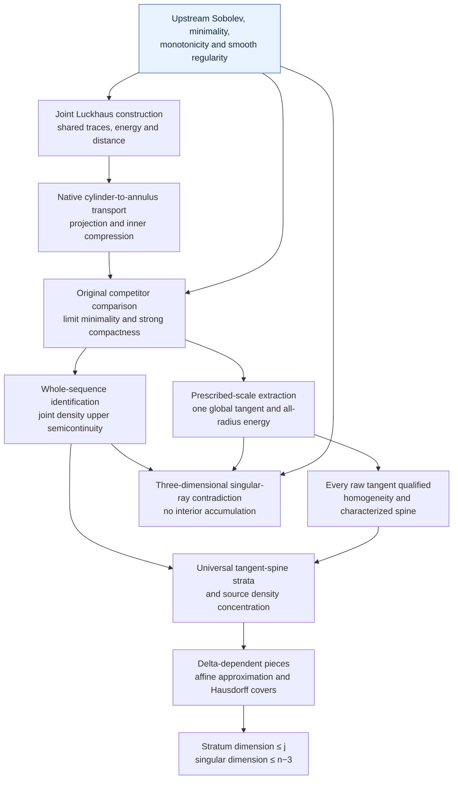

# Stratification of minimizing harmonic maps in Lean 4

[](https://github.com/BrookWW/StratificationTheoryMinimizingHarmonicMapsFormalization/actions/workflows/build.yml)
[](https://github.com/BrookWW/StratificationTheoryMinimizingHarmonicMapsFormalization/actions/workflows/kernel.yml)

A Lean 4 formalization of **strong compactness, tangent maps and singular-set
stratification for locally energy-minimizing harmonic maps**. The development
proves the joint Luckhaus interpolation estimates, limit minimality and energy
convergence, moving-center density upper semicontinuity, global tangent
extraction along prescribed scales, and the Hausdorff dimension bounds for
the universal tangent-spine strata. In dimension three the singular set has
no accumulation point inside the source domain.

The project imports the Sobolev, target, local-minimizer and small-energy
regularity interfaces from
[SchoenUhlenbeckSmallEnergyRegularityFormalization](https://github.com/BrookWW/SchoenUhlenbeckSmallEnergyRegularityFormalization).
It uses those same mathematical objects throughout. The source argument is
Giaquinta–Martinazzi, second edition, Sections 10.3.2–10.3.3, printed
pp. 250–264, with the preceding regularity and singular-set statements.
The included mathematical manuscript is
[sources/minimizer_stratification.tex](sources/minimizer_stratification.tex).
Statements, conventions and proof interfaces are explained in
[docs/stratification.md](docs/stratification.md).

## What is proved

Let $n\ge2$, let $\Omega\subset\mathbb R^n$ be open, and let
$N\subset\mathbb R^q$ be a nonempty compact smooth embedded submanifold
without boundary, with its induced metric. A source map
$u\in W^{1,2}_{\mathrm{loc}}(\Omega,\mathbb R^q)$ takes values in $N$ almost
everywhere and locally minimizes energy against every $N$-valued Sobolev
competitor whose difference from $u$ belongs to $W^{1,2}_0$ on a comparison
ball. Write

```math
E(u;B)=\int_B |Du|_{\mathrm{HS}}^2\,dx,
\qquad
\Theta_u(a,r)=r^{2-n}E(u;B_r(a)),
\qquad
\Theta_u(a)=\lim_{r\downarrow0}\Theta_u(a,r).
```

Energy has **no factor of $1/2$**. The explicit weak-gradient columns are
retained in the Sobolev predicate and energy. Comparison balls satisfy
$\overline{B_r(a)}\subset\Omega$. A point is regular when the original
Sobolev map has a smooth almost-everywhere representative on a neighborhood;
$\Sigma(u)$ is the complementary singular set.

**Stratification.** For a homogeneous tangent $\varphi$, its spine is the
actual linear subspace

```math
S(\varphi)=\{z:\Theta_\varphi(z)=\Theta_\varphi(0)\}.
```

Define $S_j(u)$ by requiring $\dim S(\varphi)\le j$ for **every tangent map**
at the singular point. For $n\ge3$ the complete theorem gives

```math
S_0(u)\subset\cdots\subset S_{n-3}(u)
=S_{n-2}(u)=S_{n-1}(u)=\Sigma(u),
```

```math
\dim_{\mathrm H}S_j(u)\le j,\qquad
\mathcal H^s(S_j(u))=0\quad(s \gt j),\qquad 0\le j\le n-3.
```

Consequently $\dim_{\mathrm H}\Sigma(u)\le n-3$, with
$\mathcal H^s(\Sigma(u))=0$ for every $s \gt n-3$. The same source theorem includes
density concentration near a j-plane and, when $n=3$, no accumulation of
singular points anywhere inside $\Omega$. This permits accumulation at the
boundary and does not assert finiteness of the full singular set.
For **$n=2$**, a separate theorem gives $\Sigma(u)=\varnothing$.
The exact complete higher-dimensional statement is
[`StratificationTheory.stratification`](StratificationTheory/Frozen/Stratification.lean).

**Compactness and energies.** A sequence of local minimizers with locally
uniform energy bounds has one strictly increasing subsequence and one
locally minimizing limit. The maps and every displayed weak-gradient column
converge strongly in $L^2$ on every compact subset. The same witnesses have
convergence of the actual Hilbert–Schmidt integrals and extended Dirichlet
energies, and vanishing difference-gradient energy, on compact subsets and
admissible open balls. The original frozen compactness interface uses finite
$W^{1,2}$ inputs; its local-input extension is used by the blow-up arguments.

**Density and tangent maps.** Given a genuine weak local $L^2$ map limit,
local equibounded energy yields its minimizing Sobolev qualifications and
strong convergence of the whole original sequence. For $y_k\to y$,

```math
\limsup_k\Theta_{u_k}(y_k)\le\Theta_u(y).
```

For every prescribed positive sequence $\rho_k\to0$, one common subsequence
of $u(a+\rho_k \cdot)$ converges strongly on all compact subsets of
$\mathbb R^n$ to a global local minimizer $\varphi$. The same limit satisfies

```math
R^{2-n}E(\varphi;B_R)=\Theta_u(a)\quad(R \gt 0),
\qquad
\varphi(\lambda\,\cdot)=\varphi\quad\text{a.e.}\quad(\lambda \gt 0).
```

Every actual raw tangent limit receives these qualifications. Tangent maps
are a relation, with no uniqueness assertion.

**Joint Luckhaus interpolation.** For every $n\ge2$, one $C_n \gt 0$ is chosen
before the target dimension, compact target set, endpoint maps and thickness.
For $0 \lt \varepsilon \lt 1/8$ and sphere Sobolev maps $u,v$ with values in that
compact set, one ambient-valued connector has both endpoint traces and

```math
\begin{aligned}
\int_{S^{n-1}\times[0,\varepsilon]}|\nabla w|^2
&\le C_n\varepsilon A+C_n\varepsilon^{-1}D,\\
\mathrm{dist}(w,N)^2
&\le C_n\varepsilon^{1-n}\sqrt A\sqrt D
  +C_n\varepsilon^{-n}D\quad\text{a.e.},\\
A&=\int_{S^{n-1}}(|\nabla_Su|^2+|\nabla_Sv|^2),\qquad
D=\int_{S^{n-1}}|u-v|^2.
\end{aligned}
```

The native cylinder columns, finite annular weak extension, radial coherence,
energy, distance and named traces belong to the same joint construction.
The connector is ambient-valued; tubular projection is applied only after
its distance bound supplies the required tube condition.

## Lean interface

The public entry point is:

```lean
module
public import StratificationTheory

#check StratificationTheory.stratification
#check StratificationTheory.luckhaus_joint
#check StratificationTheory.strongCompactness
#check StratificationTheory.strongCompactness_with_local_energy_convergence
#check StratificationTheory.exists_prescribed_weak_limit_density_joint_upper_bound
#check StratificationTheory.exists_tangent_along_prescribed_scales
#check StratificationTheory.IsTangentAt.qualification
#check StratificationTheory.singularSet_eq_empty_two_dimensional
```

The following standalone example extracts the singular dimension conclusion
from the complete canonical theorem, with the original local source inputs.

```lean
module
public import StratificationTheory

open HarmonicMaps MeasureTheory Set
open scoped ENNReal
set_option autoImplicit false

example {n q : ℕ} (hn : 3 ≤ n)
    (N : CompactSmoothEmbeddedTarget q) (Ω : OpenDomain n)
    (u : Domain n → Ambient q) (Du : Domain n → Gradient n q)
    (hu : MemW12Loc Ω u Du) (hN : TakesValuesIn N Ω u)
    (hmin : IsLocallyEnergyMinimizing N Ω u Du) :
    dimH (Subtype.val '' StratificationTheory.singularSet Ω u) ≤
      ((n - 3 : ℕ) : ℝ≥0∞) := by
  obtain ⟨_hMono, _hTop, _hTopTwo, _hTopOne, _hConcentration,
    _hStrata, hDimension, _hNullity, _hIsolation⟩ :=
    StratificationTheory.stratification hn N Ω u Du hu hN hmin
  exact hDimension
```

The two-dimensional endpoint and complete compactness interface have further
examples in [the mathematical guide](docs/stratification.md#lean-examples).

## Proof structure

Arrows indicate mathematical dependencies. Small-energy regularity and
monotonicity are imported from the pinned upstream development.



The full-annulus proposed repair of printed Corollary 10.24 is not a theorem
or hypothesis used by this proof. The proved comparison compresses the inner
map by $1+\eta$ and inserts the actual projected connector on
$r/(1+\eta) \lt |x| \lt r$, preserving the original thickness range and both trace
classes. The guide explains the complete comparison and covering arguments.

## Main exports and modules

All names below are in namespace `StratificationTheory`.

| Result or object | Export and source |
|---|---|
| Complete public entry point | [StratificationTheory](StratificationTheory.lean) |
| Complete stratification joint, $n\ge3$ | [`stratification`](StratificationTheory/Frozen/Stratification.lean) |
| Empty singular set, $n=2$ | [`singularSet_eq_empty_two_dimensional`](StratificationTheory/Foundation/TwoDimensionalEnergy.lean) |
| Uniform joint Luckhaus estimates | [`luckhaus_joint`](StratificationTheory/Frozen/LuckhausJoint.lean) |
| Strong minimizing-map compactness | [`strongCompactness`](StratificationTheory/Frozen/StrongCompactness.lean) |
| Same-subsequence local and ball energy convergence | [`strongCompactness_with_local_energy_convergence`](StratificationTheory/Compactness/GeneralStrongEnergyCompactness.lean) |
| Prescribed weak-limit density upper semicontinuity | [`exists_prescribed_weak_limit_density_joint_upper_bound`](StratificationTheory/Foundation/DensityJointUpperSemicontinuity.lean) |
| Prescribed-scale global tangent extraction | [`exists_tangent_along_prescribed_scales`](StratificationTheory/TangentMaps/PrescribedTangentExtraction.lean) |
| Raw tangent relation and all-tangent qualifications | [`IsTangentAt`](StratificationTheory/TangentMaps/TangentRelation.lean), [`IsTangentAt.qualification`](StratificationTheory/TangentMaps/TangentQualification.lean) |
| Regularity, zero density and uniform singular gap | [`regularPoint_density_characterization`](StratificationTheory/Frozen/RegularDensity.lean) |
| Named density-equality spine and its full characterization | [`spine_characterization`](StratificationTheory/Frozen/SpineCharacterization.lean) |
| Universal tangent-spine stratum | [`singularStratum`](StratificationTheory/Frozen/SingularStratum.lean) |
| Actual affine approximation and covering joint | [`HasDeltaApproximation`](StratificationTheory/Frozen/DeltaApproximation.lean), [`deltaApproximation_hausdorffMeasure_zero`](StratificationTheory/Stratification/DeltaApproximationCover.lean) |

The formalized scope is interior singular-set stratification for minimizing
maps. Rectifiability, quantitative strata, boundary regularity, the
nonuniqueness example for tangents, and regularity of merely weakly harmonic
maps are outside the statements proved here.

## Build and verify

The project pins **Lean 4.32.2**, the `harmonicMaps` dependency at commit
`f3a3097025ab9ddd956859600211d1d4edf0654e`, and Mathlib at
`905b95818eb32af7874a58b427f50c1711a5e96c`.
Dependencies are fetched through the committed Lake configuration and
lockfile; no adjacent checkout is required. With `elan` and Python 3.9 or
later installed:

```sh
lake exe cache get
lake build
python3 scripts/check_sources.py
python3 scripts/check_statements.py
python3 scripts/check_axioms.py
```

The default project build covers **712 Lean modules**. Source checks bind
the mathematical files and scan for unfinished proofs, project axioms,
resource overrides and kernel-trust bypasses. Statement checks protect
**42 complete frozen declaration interfaces**. The public entry exposes
**493 registered project exports**. Axiom checks inspect registered proof
closures and permit only `propext`, `Classical.choice` and `Quot.sound`.

Compiled declarations can also be replayed through the pinned Lean kernel:

```sh
LEAN_NUM_THREADS=2 lake --no-build env leanchecker StratificationTheory -v
```

The [build workflow](https://github.com/BrookWW/StratificationTheoryMinimizingHarmonicMapsFormalization/actions/workflows/build.yml)
runs the build and public source, statement and axiom checks.
The [kernel workflow](https://github.com/BrookWW/StratificationTheoryMinimizingHarmonicMapsFormalization/actions/workflows/kernel.yml)
also runs compiled-declaration replay. The badges report those workflows;
local proof checking and repository CI results have their respective scopes.
See [docs/verification.md](docs/verification.md) for the exact coverage of each check.

## Reuse and acknowledgments

The pinned
[Schoen–Uhlenbeck regularity development](https://github.com/BrookWW/SchoenUhlenbeckSmallEnergyRegularityFormalization/tree/f3a3097025ab9ddd956859600211d1d4edf0654e)
provides the actual Euclidean Sobolev spaces, explicit gradients, compact
smooth targets, ball-competitor minimality, affine transport, monotonicity,
tubular projection and smooth small-energy regularity. These definitions
are imported rather than reconstructed here. Mathlib supplies the underlying
analysis, integration, measure theory, finite-dimensional geometry and
Hausdorff-measure interfaces.

We acknowledge [**Scott Armstrong**](https://github.com/scottnarmstrong) and
[LeanAutoformalizationSkills](https://github.com/scottnarmstrong/LeanAutoformalizationSkills),
revision `05a07311f16bc581729e52f3e73647b95fa9bef1`, for the Lean statement-audit,
proof-dependency and verification workflow. The skill collection is licensed
under [CC BY 4.0](https://creativecommons.org/licenses/by/4.0/); its license text
is retained in [LICENSES/Armstrong-CC-BY-4.0.txt](LICENSES/Armstrong-CC-BY-4.0.txt).

The mathematical reference is M. Giaquinta and L. Martinazzi,
*An Introduction to the Regularity Theory for Elliptic Systems, Harmonic Maps
and Minimal Graphs*, second edition, Sections 10.3.2–10.3.3, together with the
preceding regularity and singular-set results. The included manuscript gives
the chosen stratification route and its precise conventions. Third-party
material retains its own licensing terms; no repository-wide license is
assigned to the new project material.
